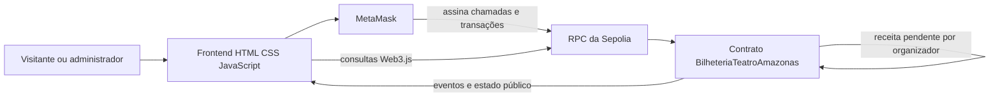

# Arquitetura da dApp

## Escopo do protótipo

A dApp demonstra uma bilheteria acadêmica inspirada no Teatro Amazonas. Todos os eventos usam a mesma planta fixa do protótipo: plateia, frisas laterais e camarotes. O visitante escolhe um assento identificado por letra e número, consulta a disponibilidade e compra pagando SepoliaETH. A blockchain confirma a compra e impede uma segunda compra da mesma cadeira.

O protótipo usa eventos fictícios e não vende ingressos reais nem representa uma integração oficial com o Teatro Amazonas.

## Componentes

## Fluxos principais

### Administração

1. O administrador conecta a carteira que implantou o contrato.
2. Cadastra um evento com nome, data, local, preço-base, ajuste opcional (desconto ou adicional), referência hash opcional para detalhes extensos e organizador. O mapa fixo tem 120 lugares.
3. Pode alterar o estado do evento para cancelado ou encerrado.

### Compra de ingresso

1. O visitante escolhe o evento e seleciona uma cadeira fixa livre pelo código mostrado no mapa.
2. O frontend consulta o preço e pede confirmação da transação na MetaMask.
3. A função `comprarIngresso` valida evento, ID fixo da cadeira (1 a 120), disponibilidade e valor enviado.
4. O contrato grava o ingresso e associa o assento ao ingresso. Uma segunda compra do mesmo assento é rejeitada.
5. A receita fica contabilizada para o organizador, que pode sacá-la pela função `sacarReceita`.
6. A interface apresenta o hash, o estado da transação e o link do Etherscan.

## Dados na blockchain

- **On-chain:** dados básicos do evento, inventário fixo de 120 cadeiras, IDs ocupados, preço, estado, endereço do comprador, ingresso e valores pendentes do organizador.
- **No frontend:** apresentação visual do mapa e detalhes estáticos. Não guardar chaves privadas, frases de recuperação ou dados pessoais sensíveis.

## Modelo inicial

- `Evento`: nome, data, local, preço-base e ajuste assinado em wei, hash opcional do programa, organizador, capacidade fixa de 120, quantidade vendida e estado.
- `Ingresso`: evento, ID fixo do assento, comprador e valor pago.
- `StatusEvento`: agendado, cancelado ou encerrado.
- Inventário on-chain: IDs numéricos de 1 a 120; compras com qualquer outro ID são recusadas.
- Mapa visual: `frontend/mapa-assentos.js` associa cada ID ao código e à posição, como `A-01`, `FL1-01` ou `CR2-05`.
- Disponibilidade: mapping aninhado de evento → ID fixo de cadeira → ingresso.
- Ingressos do usuário: mapping de endereço → lista de IDs de ingresso.

## Recursos Solidity mapeados

| Grupo | Uso previsto no contrato |
|---|---|
| Tipos de dados | `uint256`, `int256` para ajuste de preço, `bool`, `address`, `address payable`, `string`, `bytes32` para referência de conteúdo, além de `constant` e `immutable` |
| Funções | Cadastro, alteração de estado, compra, saque e consultas com visibilidades e `view` apropriados |
| Estruturas de controle | Validações com `if` e laço limitado a 50 IDs por chamada ao paginar ingressos |
| Arrays e mappings | Lista de eventos, lista de ingressos por usuário e disponibilidade por evento/ID fixo do assento |
| Structs e enums | Estruturas `Evento` e `Ingresso`, enumeração de estados do evento |
| Modificadores | Restrição administrativa, proteção de reentrância e validações reutilizáveis |
| Eventos e erros | Eventos de cadastro, alteração, compra e saque; erros personalizados para falhas de negócio |

Os recursos devem ser efetivamente utilizados e identificados nos comentários do contrato e na tabela final do README.

## Limites do MVP

- A planta é esquemática e inspirada na imagem de referência; não declara reproduzir o mapa oficial de lugares do Teatro Amazonas.
- Cada evento usa a capacidade fixa de 120 assentos definida no contrato.
- Mudanças no inventário numérico exigem recompilar e implantar uma nova versão do contrato.
- O protótipo não integra com o sistema real do teatro nem valida a entrada física no local.
- Dados escritos na Sepolia são públicos; evitar armazenar dados pessoais que não sejam necessários.
- O saque usa padrão de retirada pelo organizador, para manter a compra sem chamada externa ao recebedor durante a transação.
